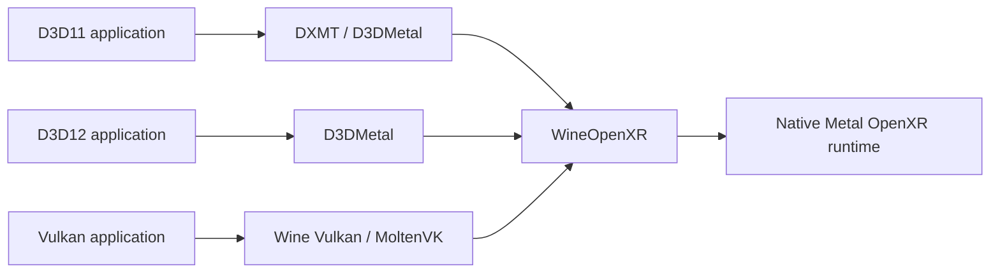

# WineOpenXR

WineOpenXR runs Windows OpenXR applications against a native Metal OpenXR runtime.
It supports D3D11 through DXMT or D3DMetal, D3D12 through D3DMetal, and Vulkan
through CrossOver's MoltenVK driver.

Swapchain textures share GPU storage. Vulkan images are created once around the
runtime's Metal textures. The native session uses the application's Metal command
queue, so submitted rendering precedes runtime composition without a CPU GPU wait.
D3D11 and D3D12 use a shared Metal event between the application's queue and the runtime.
D3DMetal receives runtime-owned textures or compatible views during allocation;
the bridge performs no frame copies or CPU readback.

## Requirements

- macOS on Apple Silicon, with Rosetta for the x86_64 host bridge.
- D3D11: DXMT's `IMTLD3D11InteropDevice`, or D3DMetal with synchronous native
  texture allocation and shared fence events. D3DMetal runtime textures require
  Private storage, matching device/layout/usage and compatible pixel formats.
- D3D12: `CX_GRAPHICS_BACKEND=d3dmetal` before extension discovery, a DIRECT
  queue belonging to the binding device, and the same native texture/event
  requirements. Supports unprotected, single-sample 2D attachment swapchains,
  including arrays. Color images use `RENDER_TARGET`; depth uses `DEPTH_WRITE`.
- Vulkan: CrossOver 26.3.0, Wine build `wine-11.0-8726-g2e2f5fca349`.
  The bridge verifies this private Wine handle ABI before unwrapping handles.
- Vulkan: `MVK_CONFIG_SYNCHRONOUS_QUEUE_SUBMITS=1` set before starting Steam or
  the game. Restart existing processes after changing it. This orders CPU command
  encoding and submission; it does not wait for GPU completion.
- A native x86_64 runtime exposing `XR_KHR_metal_enable`.

Vulkan applications can use `XR_KHR_vulkan_enable` or `XR_KHR_vulkan_enable2`
with Vulkan 1.0 through the installed driver's version, capped at 1.3.
Graphics requirements must be queried for the session's API and system before
creating a session. The application owns its Vulkan instance and device and must
keep them alive until its OpenXR sessions and swapchains are destroyed.

## Build

Headgasket's `just init-dev` initializes the pinned dependencies. `just build-wineopenxr`
builds the bridge using the repository's pinned Vulkan headers and source commits.
Build tools are CMake, MinGW and Xcode.

The two artifacts are `wineopenxr.dll`, a Wine PE builtin, and `wineopenxr.so`,
an x86_64 host library. Headgasket's bottle installer installs and registers them.

## Diagnostics

Enable Wine's `+openxr` channel. Vulkan failures retain their `VkResult` in logs;
the OpenXR call returns the applicable `XrResult`. Unsupported Wine handle ABIs
and asynchronous MoltenVK submission configurations fail session creation.

## License

LGPL-2.1-or-later. See `LICENSE` and `COPYING.LIB`.
